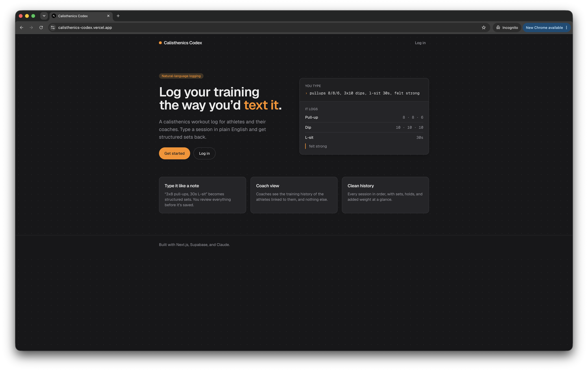
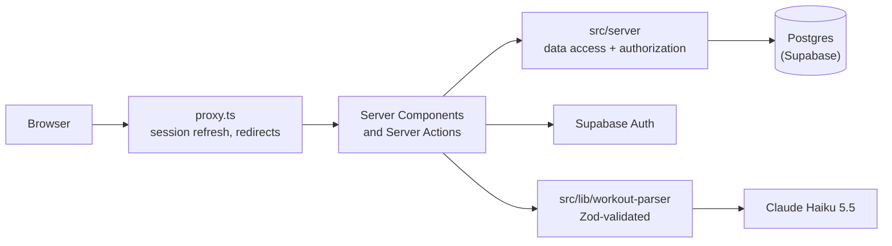

# Calisthenics Codex

[](https://github.com/atom-morgan/calisthenics-codex/actions/workflows/ci.yml)

A workout log for calisthenics athletes and their coaches. Type a session the way you'd text it ("pullups 8/8/6, 3x10 dips, l-sit 30s") and it becomes structured sets you review before saving. Athletes can share their history with a coach, who gets a read-only view with progress charts.

**Live:** [calisthenics-codex.vercel.app](https://calisthenics-codex.vercel.app) · Demo coach and athlete accounts are available on request.



## How it was built

This app was built over four days as a portfolio project, pairing with [Claude Code](https://claude.com/claude-code), as a way to show a modern full-stack workflow. The process was deliberate:

- **Plan, then build.** Each day started with a written plan that was reviewed and approved before any code.
- **Small, reviewed commits.** Every change was read before it was committed; the history reads as a sequence of single-purpose commits.
- **Written conventions.** [`CLAUDE.md`](CLAUDE.md) holds the project's standards (validation, authorization, comments, file layout) and how to work in this repo.
- **Decisions and lessons logged as they happened**, rather than reconstructed at the end.

## Features

- **Natural-language entry.** Free text goes to Claude (server-side only) and comes back as structured sets: shorthand (`3x8`, `8/8/6`), ladders and rounds, holds, added weight, and kg conversion. The result fills the normal form, so nothing is saved until you've reviewed it, and anything the parser couldn't read is shown as a warning instead of guessed.
- **Manual logging** with any number of exercises and sets, reps or hold time, and added weight. New exercises are created on save.
- **History and progress.** Recent workouts, and a per-exercise chart of your best set each session (reps, hold time, or added weight, picked from how you log it).
- **Coaching.** Users sign up as an athlete or a coach. Athletes add a coach by email and can remove them at any time; coaches see only athletes who added them, read-only.

## Stack

Next.js 16 (App Router, Server Components, Server Actions) · React 19 · TypeScript (strict) · Tailwind CSS 4 · Postgres on Supabase with Drizzle ORM · Supabase Auth · Zod 4 · Anthropic API (Claude Haiku 5.5) · Recharts · Vitest with PGlite · GitHub Actions · Vercel

## Architecture



- **Authorization lives next to the data.** Every function in `src/server/` takes the user id from `requireUser()` and filters by it; coach access goes through a link-table check. Proxy and layouts only redirect. Supabase's REST API is shut off with row-level security and no policies, so the app's server is the only way in.
- **LLM output is never trusted.** Structured output fixes the shape; every set is then validated with the same Zod schema as the manual form; the user reviews the draft; and the save is validated again like any other input.
- **Mostly server-rendered.** Pages are Server Components that read straight from the data layer. Client components are limited to forms, the nav, the chart, and error boundaries. UI state that the server needs (like the selected exercise) lives in the URL.

```
src/
  app/            routes: (auth) login/signup, (app) workouts, progress, sharing, athletes
  server/         data access and authorization (server-only)
  lib/            framework-agnostic logic: validation, formatting, progress, workout-parser
  components/     shared UI; components/ui holds the primitives
  db/             Drizzle schema, client, and seed scripts
  test/           in-memory test database
drizzle/          SQL migrations, including the hand-written profile trigger
docs/             decisions.md and lessons.md
```

## Key decisions

Short records with the reasoning and the alternatives are in [`docs/decisions.md`](docs/decisions.md). The ones that shaped the app most:

- **Server-side authorization in a data access layer**, with Proxy as an optimistic redirect only (3, 4).
- **Athletes grant coach access; coaches can't request it**, and denied access is a 404 so ids can't be probed (18, 19).
- **Natural-language entry fills the form**, so parsed data has the same review step and save path as manual entry (11, 12).
- **Haiku for parsing, chosen by an eval**: same accuracy as Opus on the test set, faster, and about a fortieth of the cost (13).
- **Database tests on PGlite**, real Postgres in memory with the real migrations, so no Docker or secrets in CI (20).

## Lessons

Bugs, gotchas, and surprises are written up in [`docs/lessons.md`](docs/lessons.md) with the cause, fix, and takeaway. A few favorites:

- Zod runs checks in chain order, so `z.email().trim()` rejects `" a@b.co"` (1).
- A strict structured-output schema makes the SDK throw away the whole response over one bad value (15).
- A new prompt rule silently broke an old case, caught by re-running the eval (17).
- Authorization tests that passed even with the access check deleted, and how the setup was fixed so they can fail (18).

## Testing

- **Unit tests** for validation, the form reducer, formatting, progress, and the parser (with canned model responses).
- **Database tests** for everything in `src/server/`, run against PGlite with the real migrations and a stub of Supabase's `auth.users`, so the profile trigger, constraints, and access rules run as real SQL. They include the authorization rules: an athlete can't read another athlete's data, and a coach can only read linked athletes.
- **Parser eval** (`npm run eval:parser`) runs fixed inputs through the real model and scores the results. It's kept out of CI because it costs money and isn't deterministic.
- **CI** runs format, lint, typecheck, tests, and a production build on every push.

## Running locally

You'll need Node 24, a Supabase project, and an Anthropic API key.

```bash
npm install
cp .env.example .env.local   # fill in the values; each one is documented there
npm run db:migrate           # create the schema
npm run db:seed              # exercise catalog
npm run db:seed:demo         # optional: demo coach and athletes (needs DEMO_PASSWORD)
npm run dev
```

Other scripts: `npm test`, `npm run typecheck`, `npm run lint`, `npm run format`, `npm run eval:parser`.

## What I'd do next

- **Edit and delete workouts.** Logging is create-only today, which was a deliberate scope cut.
- **Rate-limit parsing** with shared storage, since an in-memory limiter doesn't work on serverless (decision 15).
- **Coach invite links** that sign an athlete up already linked to the coach.
- **A metric toggle on progress charts**, e.g. reps and added weight for weighted pull-ups (decision 21).
- **Per-user exercise lists**, showing seeded exercises plus your own instead of one shared catalog (decision 14).
- **RLS policies as a second layer** behind the data access layer.
- **End-to-end tests** with Playwright for the main flows.
